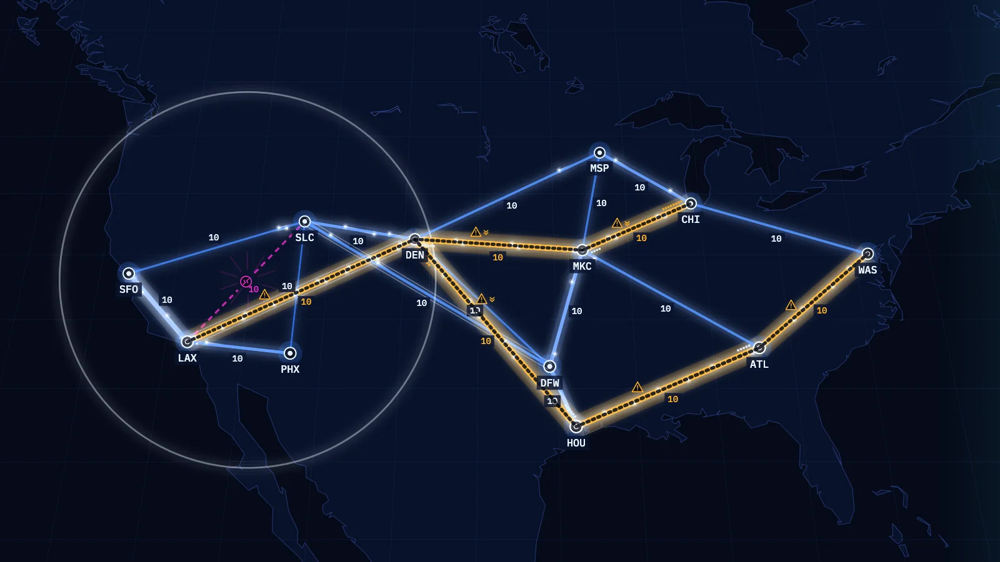

# Backbone

**Build the backbone. Never steer a packet. Predict where the congestion goes.**

> **This folder is a copy.** It is the repository [E-Conners-Lab/backbone](https://github.com/E-Conners-Lab/backbone) at commit `43fc375`, added to the workshop's examples. The files are unchanged apart from this note. Where this page says "the repository root", it means this folder, `WORKSHOP/LAB/Examples/Backbone`: run every command from here.

Backbone is a browser game for network engineers. You are the architect of a growing backbone network. You lay fiber between sites, set link costs and upgrade capacity, and every packet takes the lowest-cost path as OSPF would route it. Each change reroutes everything, and the game shows you where the load went.

A project from **NAF AC6 — Loop Engineering, Spec-Driven Development & the Future of VibeOps**, built as an example for the workshop Arcade. This is the version rebuilt through the workshop's seven Spec Kit steps. The earlier hand-built version is kept under the tag `v1-handbuilt`.



| Project | Details |
| --- | --- |
| Status | **Playable v1, rebuilt through Spec Kit.** Verified by automated tests in Chromium. The owner says he has played and tested it: in a web browser for about 6 or 7 minutes, and on an iPhone 17 Pro, where he says it feels smooth (his report, 2026-11-10; not observed, timed or measured by the build). |
| Networking topic | OSPF shortest path by cost, equal-cost next hops, reconvergence after a failure (RFC 2328) |
| Typical session | The scripted player's runs last 6¼ to 7¼ minutes on eight seeds. The owner reports playing for about 6 or 7 minutes; that was not timed. |
| Live demo | Not published |
| Built by | Elliot Conner with Claude Code |

## The challenge

Three cities appear on a dark map and will start sending traffic to each other in 20 seconds. You drag fiber between them from an 8,000 km budget. Another city appears every 40 seconds. Every link starts at cost 10 and carries 4 packets a second in each direction, with room for 8 more to wait. When a link fills it turns amber and striped, and every packet it refuses lands on the drop meter. One hundred drops and the run is over.

A typical decision: five sites A to E. Links A–B, B–C, A–D and D–C cost 10, the direct link A–C costs 25. Traffic from A to C goes A–B–C at cost 20 and B–C turns amber. You upgrade A–C, expecting traffic to move to the bigger link. Nothing moves, because capacity does not change cost. You pause, lower A–C to 19, resume, and every pulse from A to C changes course to the direct link. Now A–C is the link to watch.

## What you'll learn

| By the end, you can… | You'll practice by… |
| --- | --- |
| Identify the lowest-cost path between two sites from link costs | Laying links, setting costs, and checking a router's table in the inspector against where the pulses go |
| Predict where load moves after a cost change, a new link or a cut | Making a change while paused, resuming, and watching utilization shift |
| Design redundancy so one fiber cut leaves no site without a path | Surviving fiber cuts, which begin 2½ minutes into a run |

**Before playing:** you should know what a router, a link and a routing metric are. No OSPF configuration experience is needed.

## Play locally

The built game is in `dist/` and needs no install. From the repository root:

```sh
python3 -m http.server 8791 --bind 127.0.0.1 --directory dist
```

Open **http://127.0.0.1:8791**. Press Ctrl+C to stop the server. Any free port works; use the same number in both places. On Windows the Python launcher is `py` in place of `python3`; that was not tried here.

To work on the source you need Node (26.3.1 was used):

```sh
npm ci
npm run dev        # development server
npm run build      # type-check, then build into dist/
```

## How to play

1. Read the briefing card and press Start. Type a seed to repeat a run exactly, or leave the field empty for a random one.
2. Link the first three sites before their 20 seconds are up. A site with no path is dark, and its traffic is dropped.
3. Watch where the pulses go. Brighter, thicker links carry more. Amber and striped means congested.
4. Pause whenever you like. Every tool works while paused, and your changes take effect together when you resume.
5. Every minute time stops and you choose a reward: 3,000 km of fiber or one capacity upgrade. Changes you make while choosing wait until you choose, as in a pause. Fiber cuts start after 2½ minutes.

| Control | Action |
| --- | --- |
| Drag from one site to another | Lay a fiber link. The drag shows the length and whether you have the fiber. |
| Tap or click a link | Open its options: cost, capacity upgrade, remove |
| Pinch, or mouse wheel, or + and − | Zoom |
| Two-finger drag, or drag empty map, or arrow keys | Pan |
| Space, or the Pause button | Pause and resume |
| I, or the Inspector button | The inspector: every site, every link and each router's table, as text |
| 1, 2, 3, 4 | Select a tool: lay link, set cost, upgrade, remove |
| Escape | Close a panel or cancel a link in progress |
| Keyboard only | In the inspector, press Enter on a site to start a link and Enter on another site to finish it. Press Enter on a link for its options. |

**Progress:** your score is the traffic delivered; time survived is recorded beside it. A run ends only when the drop meter fills. The five best scores are kept on this device and shown on the welcome screen after a reload. Starting again is free.

## What this game models

Single-area OSPFv2 (RFC 2328) over point-to-point links. Every router forwards a packet to the neighbor on the path with the smallest sum of link costs to the destination. When the topology or a cost changes, every router recomputes. The same list is in the game's "About the model" panel.

**Faithful to RFC 2328**

| # | In the game | Source |
| --- | --- | --- |
| F1 | Each site is a router. It works out the lowest-cost path to every other site. A path's cost is the sum of the costs of its links, and the lower sum wins. | §16.1 |
| F2 | A link cost is a whole number from 1 to 65535. Zero is not allowed. | §C.3, §A.4.2 |
| F3 | When two or more paths to a destination cost the same, the router records every tied next hop. | §16.1 step 2(d), §16.8 |
| F4 | A router may keep fewer than all of its equal-cost routes. In this version each router keeps one. | §16.8 |
| F5 | Forwarding is hop by hop. Every router on the way uses its own table, so traffic is divided at each router among that router's next hops, not evenly across whole paths. | §16.1, §16.1.1 |
| F6 | A link is used only if both of its ends report it. A cut removes it in both directions. | §16.1 step 2(b) |
| F7 | When a link goes down or a cost changes, every router recomputes its table and traffic follows the new tables. | §9.2, §13.2 |
| F8 | Cost is configuration. It does not react to load. A congested lowest-cost path stays the path until you change something. | §C.3 |

**Simplified for play**

| # | What the game does | What a real OSPF network does |
| --- | --- | --- |
| S1 | One area, point-to-point links only, one router per site | Areas, broadcast networks with Designated Routers, stub networks, external routes, virtual links |
| S2 | One cost per link, used in both directions | Cost is per interface, so the two directions can differ |
| S3 | Convergence is instant: detection, flooding and the path calculation finish in one simulation step. The ripple is a visual effect. | Routers take time to detect a failure and flood the news; they disagree briefly and can loop packets |
| S4 | Equal-cost sharing is per packet, in strict rotation. It is not a player tool in this version. | Routers keep each flow on one path, usually by hashing, to avoid reordering (RFC 2991) |
| S5 | Packets are one size. Each link direction serves a fixed number per second from a short first-in-first-out queue and drops what arrives at a full queue. Senders never slow down. | Variable packet sizes, TCP backing off under loss, QoS classes, active queue management |
| S6 | New links get cost 10. Upgrading capacity does not change cost. | RFC 2328 does not say how to choose a cost. Deriving it from bandwidth is a common vendor default, not part of the standard. |
| S7 | With one route kept, a tie goes to the neighbor with the lowest router ID | RFC 2328 does not say which route to keep; implementations differ |
| S8 | One pulse is one simulated packet | Billions of packets |
| S9 | Only links fail | Routers fail too |
| S10 | Packets on a link, or queued for it, are lost when it is cut or removed | Broadly true of a fiber cut; real loss also continues until convergence completes |
| S11 | Travel time along a link is proportional to its length on the map, scaled for play | Propagation delay is real but far smaller than shown |

**Outside the model:** adjacency formation, Hello and database exchange, LSA aging, authentication, areas, route summarization, external routes, BGP, MPLS, traffic engineering, and unequal-cost sharing.

| Reference | What it supports |
| --- | --- |
| [RFC 2328, OSPF Version 2](https://www.rfc-editor.org/rfc/rfc2328), §16.1, §16.1.1, §16.8, §13.2, §9.2, §A.4.2, §C.3 | Shortest path by cost, equal-cost next hops, the back-link check, recalculation after a change, the legal cost range |
| [RFC 2991, Multipath Issues in Unicast and Multicast Next-Hop Selection](https://www.rfc-editor.org/rfc/rfc2991) | Why per-packet sharing is a simplification of real per-flow hashing |

## How it was built

The project follows the workshop's Spec Kit workflow: **constitution → specify → clarify → plan → tasks → analyze → implement**. The verification section below records which behaviors have actually been checked.

- **Stack:** TypeScript, Vite, no runtime dependencies. The renderer is the project's own WebGL2 code with a Canvas 2D fallback; both draw one shared scene. IBM Plex Sans and IBM Plex Mono are shipped with the build.
- **Build tools:** Claude Code 2.1.322 with model `claude-fable-5-2`. GitHub Spec Kit 1.2.2. Vitest for unit tests, Playwright for end-to-end tests and video, FRR 10.7.1 in Docker as a reference OSPF implementation.
- **Runtime:** a browser. Static files only. No network, account, model or API key.
- **Planning inputs:** `StarterKit/CONSTITUTION.md`, `StarterKit/SPEC.md`, `StarterKit/PLAN.md`, approved by the owner on 2026-11-09.
- **Working artifacts:** `.specify/memory/constitution.md` (version 1.1.0) and, in `specs/001-backbone-first-playable/`, `spec.md`, `plan.md`, `research.md`, `data-model.md`, `contracts/`, `quickstart.md`, `tasks.md` and `checklists/requirements.md`.
- **Records:** `PROVENANCE.md` (what was used and every verification step), `docs/capture-log.md` and `docs/runbook.html` (the build log and build book), `docs/verification/` (results, the analysis report, the hand trace, the text review, the FRR result, the videos), `ARCADE.md` (the Arcade submission).
- **One useful design decision:** the clarify step fixed the order of work inside a simulation step from a hand-worked case. A link offered 6 packets a second with room for 4 must end 10 seconds with 40 served, 8 queued and 12 dropped. Only "serve, then accept arrivals" gives those numbers; the other order gives 40, 7 and 13.
- **Where it lives:** the rebuild was made on branch `speckit-rebuild`. The hand-built version it replaces is tag `v1-handbuilt`.
- **Where this build departed from the lab:** the lab says to read what each step produces before the next. The owner reviewed step 1 and then asked for the rest to run unattended, so steps 2 to 7 were not reviewed one by one, and the five clarify questions were answered by the agent from the owner's approved decisions. Those answers are marked in the spec for his review.

## Verification

**Last checked:** 2026-11-10, with the tests run again on 2026-11-11, macOS 26.7.1 (Darwin 25.6.0, arm64), Node v26.3.1, Playwright 1.65.0 with its bundled Chromium headless shell 158.0.8127.18. The game's code is as of commit `9b813ab` on branch `speckit-rebuild`. Later commits change records (among them the spec's `research.md` and `tasks.md`) and the tool that builds the build book (`tools/build_runbook.py`), the videos, the card image and the tool that makes it (`tools/make-card.mjs`), a comment in `tools/serve-dist.mjs`, and one end-to-end test helper (`censusRun` in `tests/e2e/helpers.ts`, whose last shot was not of a game-over screen until 2026-11-11); they also remove one unused development tool and one unlinked picture. No game code changed (`src/` is as of `9b813ab`). After the card image was replaced, the unit tests, `verify:dist` and the end-to-end tests that load the welcome screen were run again. On 2026-11-11, with the census helper corrected, the type check, the unit tests (124 pass), `verify:dist` (13 files) and the whole end-to-end suite (74 pass, 4 skipped by design) were run again on the same machine.

```sh
npm test               # unit tests (Vitest)
npm run build          # type-check, then build into dist/
npm run verify:dist    # the committed dist/ equals a fresh build
npm run test:e2e       # end-to-end tests against dist/ (Playwright, Chromium)
npm run record         # the seeded-run videos
python3 tools/frr_check.py   # compare the routing cases with FRR in Docker
node tools/confirm-runtime.mjs   # run the game once as ARCADE.md's Runtime section says
```

| Check | Result | Evidence / notes |
| --- | --- | --- |
| Spec cases 1–12 (correct, tie, boundary, cut, no path, overload, score, determinism) | Pass | `npm test`: 124 of 124 pass. Expected values come from `tests/fixtures/ospf-cases.json`, typed from the spec. |
| Routing against an independent brute-force oracle | Pass | Every router pair on 320 seeded random graphs |
| Routing against a real OSPF implementation | Pass | `tools/frr_check.py`: 21 of 21 compared routes match FRR 10.7.1, all adjacencies Full. Case 6's tie-break is the game's own rule and is not compared. `docs/verification/frr-check.json` |
| Same seed and inputs give the same run | Pass | Hash equal at every step across two plays and across a replay from the command log; in the browser, two scripted runs end on the same score and the time-lapse replays to it |
| Simulation is pure (no DOM, clock, random or renderer) | Pass | Source scan in `tests/unit/purity.test.ts` |
| A new region is data only | Pass | The unchanged simulation runs on a trial region; one packet traced by hand in `docs/verification/hand-trace.md` |
| Explanatory text checked against the spec and RFC 2328 | Pass | `docs/verification/text-review.md`. One reviewer, the agent that wrote the text. |
| All 26 acceptance criteria | Pass | `npm run test:e2e`: 74 pass, 4 skipped by design (each is checked at the other screen size). Per-criterion table in `docs/verification/results.md`. |
| Full run at 1920×1080 by mouse and at 844×390 by touch | Pass | End-to-end tests with real pointer and touch events |
| Game over, play the same seed again, new run, best scores after a reload | Pass | End-to-end tests at both sizes; a damaged stored score is dropped, and the game still plays when the device refuses storage |
| Keyboard-only play with visible focus | Pass | Chromium, desktop size |
| Reduced motion; device setting followed | Pass | No sweep, no trails; every link, site, label and icon still drawn |
| Play without WebGL; WebGL lost mid-run | Pass | Automatic fallback to Canvas 2D; both renderers report the same scene for the same step |
| No green, no red | Pass | Every authored color is outside both hue bands. Census of screenshots in both renderers at five moments and both sizes: 0 pixels in either band. |
| Text contrast and size; every control named | Pass | Contrast at least 4.5 to 1; no text under 16 px at 1920×1080 or 11 px at 844×390; every control on every screen has a readable name |
| Plays offline as plain files | Pass | A whole run with the network cut; no request to another host |
| Code review of the source, tools and tests | Done | Three rounds of `/code-review` at level high: 30 findings, 27 fixed, 3 left with their reasons. Each fix that could have a test has one that fails without it. The third round's fixes were tested but not reviewed again. The reviewers were other sessions of the same model, not people. `docs/verification/results.md` |
| `dist/` matches the source | Pass | `npm run verify:dist`: 13 files equal a fresh build, in the working folder and in a fresh clone |
| Seeded-run videos at both sizes | Pass | `docs/verification/run-stage-1-844x390.mp4`, `run-stage-1-1920x1080.mp4`: the scripted player on seed `stage-1`, 7,302 delivered in 6:51 in both, equal to the same run in Node with no browser. Not a person's run. |
| Fresh copy: serve `dist/`, install, test, build, end-to-end | Pass | From a clone of this branch in an empty folder: `dist/` served as it is, then `npm ci`, 124 unit tests, the build, `verify:dist` and 74 end-to-end tests. Run by the build agent on the build machine, not by another engineer. Repeated on 2026-11-10 on the merged `main` (`6a82d27`), cloned from GitHub with no login: every step passes, and the runtime check holds 8 of 8. |
| `ARCADE.md` Runtime section | Confirmed | `node tools/confirm-runtime.mjs` runs the file's own start command, opens the URL with no test switches, plays a run to game over offline and reloads: 8 of 8 claims hold |
| Frame time | Recorded, not a pass | Headless Chromium on the build machine, where WebGL runs in software: 36 frames a second at 1920×1080 with WebGL, 60 with the fallback and at phone size. Main-thread work is under 1 ms a frame. This is not a phone measurement. |
| Played by a person | Owner's report | The owner said on 2026-11-10: "I did play it and test it", in a web browser (which one was not said), and later that he was playing on an iPhone 17 Pro. The build did not observe it. |
| A person's run lasts 5 to 10 minutes | Owner's report, not timed | He played for "about 6 or 7 minutes" (SC-013). An estimate; whether it was one run from Start to game over was not said. |
| A tester explains a bad cost change from the screen alone | **Not run** | SC-011 needs a record of what the tester said |
| 60 frames a second on a mid-range phone | **Not run** | SC-012 asks for a measured frame rate on a mid-range phone. The owner says the game "feels smooth" on an iPhone 17 Pro; that is a high-end phone and an impression, not a measurement. |
| A real phone | Owner's report | An iPhone 17 Pro (2026-11-10); the browser on it was not said. Not checked by the build. |
| Screen readers; browsers other than Chromium | **Not run** | By the build. Which browsers the owner used was not said. |

## Known limitations and next steps

- **Play by a person rests on the owner's report, not on a recorded test.** He said on 2026-11-10 that he played and tested the rebuilt game in a web browser for about 6 or 7 minutes, and then that it feels smooth on an iPhone 17 Pro. Nothing was timed or measured; frame rate on a mid-range phone and the tester evidence of SC-011 are open.
- **Chromium only.** Other browsers are not verified.
- **It looks plainer than the approved mock.** Site rings are white, not the mock's cyan, because cyan beside an amber link blends into the green band. The mock's reward countdown and cut countdown are not on the map; the inspector shows a cut's repair time.
- **Labels can overlap** where links are short or sites are close together, most of all at phone size.
- **The game-over card covers part of the map.** While the time-lapse plays behind it, the western sites are under the card.
- **The inspector does not trap focus**, and no screen reader has been tried.
- **Reward offers are the same every time.** The approved spec says the seed decides them, and the plan gives one offer; this is open for the owner as K6 in `docs/capture-log.md`.
- **There is no way to export a replay.** The same seed gives the same sites, traffic and cuts, but the same run only with the same actions.
- **Next:** v1.1 adds attract mode and sound for the stage; v1.2 adds equal-cost load sharing as a tool (the engine and tests already cover it) and maintenance windows; v1.3 the four-region campaign; v1.4 seed-generated maps.

Found a wrong route? Open an issue with the seed, the links and costs, the two sites, what the game did and what you expected.

## Credits

Created by Elliot Conner with Claude Code. Workshop by John Capobianco, Joksan Flores, and Elliot Conner. Adapted from the [NAF AC6 workshop materials](https://github.com/automateyournetwork/NAF_AC6) (Apache-2.0) and [Networking Video Game Starter Kit](https://github.com/automateyournetwork/NetworkingVideoGameStarterKit), using [GitHub Spec Kit](https://github.com/github/spec-kit).

**Assets and dependencies:** city positions, coastline and lakes from [Natural Earth](https://www.naturalearthdata.com/) data (public domain). [IBM Plex](https://github.com/IBM/plex) Sans and Mono (SIL Open Font License 1.1), bundled through the `@fontsource` packages; the licence text is in `public/licenses/`. The hero image is a frame rendered by the game itself. Everything else is original to this project.

**License:** Apache-2.0. See [LICENSE](LICENSE).
